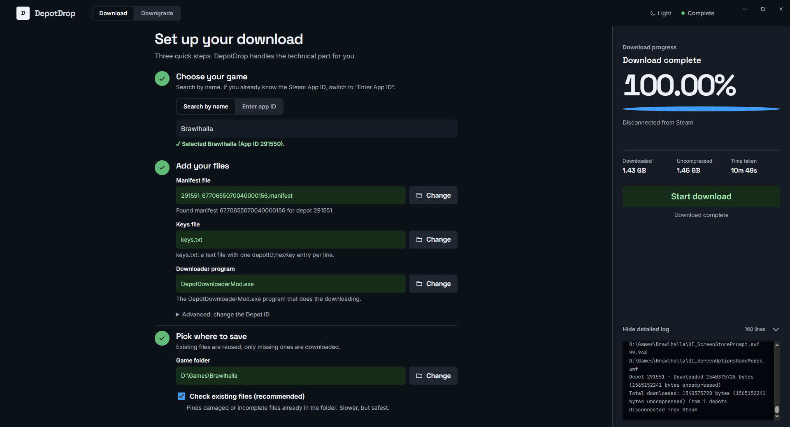
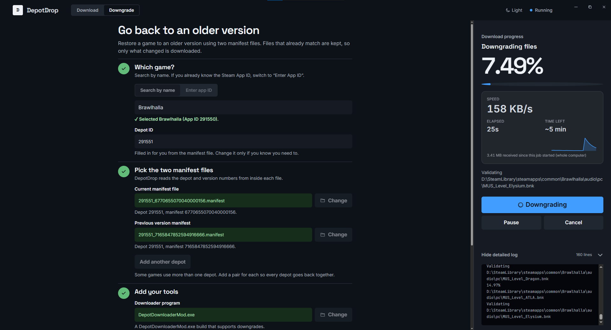

# DepotDrop

> A small Windows desktop UI for downloading and validating a Steam depot without typing a long DepotDownloader command.

DepotDrop wraps the local `DepotDownloaderMod.exe` workflow with guided setup: choose the manifest, app ID, downloader executable, depot keys, and destination folder, then watch the real downloader progress in the app.

## Built with

[](https://go.dev/)
[](https://github.com/wailsapp/wails)
[](https://developer.mozilla.org/docs/Web/JavaScript)
[](https://vite.dev/)
[](https://webawesome.com/)
[](https://store.steampowered.com/)
[](https://github.com/SteamAutoCracks/DepotDownloaderMod)
[](https://playwright.dev/)

**Download** a depot from a manifest:



**Downgrade** a game to an older version from two manifest files, with live speed, elapsed time and time left:



## Download for Windows

Download the latest ready-to-run `.exe` from the [GitHub Releases page](https://github.com/wahajnintyeight/DDM-GUI/releases/latest). The packaged app requires the Windows WebView2 Runtime, which is already present on most current Windows installations.

## Features

**Download tab**
- Pick a game by name (Steam Store search, no API key) or type any numeric app ID.
- Reads the depot and manifest IDs from a `DEPOTID_MANIFESTID.manifest` file; nothing is tied to a particular game.
- Choose your own `DepotDownloaderMod.exe`, `keys.txt` and destination folder.
- **Check existing files** (on by default) adds `-validate` so damaged or incomplete files are repaired. Arguments are passed straight to the process, never through a shell.
- Pause, resume and cancel at any time; interrupted downloads pick up from the files already on disk.

**Downgrade tab**
- Restore a game to an older version from two manifest files: the **current** manifest and the **previous version** manifest. Depot IDs are filled in from inside the files, and a game search fills the app ID.
- Works with your regular `DepotDownloaderMod.exe`. No special downloader build is needed.
- Safe order of operations: it checks every input first, downloads and validates, then verifies every file of the older version against its manifest. Only after that does it remove files that exist in the current version but not the older one.
- A second automatic pass checks every file against the older manifest and repairs any difference, so the game does not need a manual re-validate afterwards.
- Never touches unrelated files such as saves or settings, rejects manifest paths that would escape the game folder, never writes depot keys to logs, and refuses to run two jobs at once.
- Games with several depots: add a pair of manifests per depot, or confirm a partial downgrade (nothing is removed in that case).

**Live job panel (both tabs)**
- Download speed with a one-minute graph, elapsed time and a smoothed estimated time left.
- Speed is read from the computer's network adapters, so it also reflects other programs using the connection and sits near zero while files are only being checked on disk.
- Elapsed time excludes time spent paused; a detailed output log is available.

## Quick start

You need these local inputs:

```text
DepotDownloaderMod.exe
keys.txt
<depotID>_<manifestID>.manifest
```

### `keys.txt` format

Use plain text with one depot key per line:

```text
<depotID>;<hexKey>
```

For example, a file containing keys for two depots has two lines. Use the 64-character hexadecimal depot decryption key supplied for each depot; do not include quotes or extra formatting.

They do not need to be in the same folder. DepotDrop never downloads, embeds, uploads, or commits the downloader or keys file; users select their own trusted copies.

Then:

1. Build or download `DDM-GUI.exe`.
2. Open the app.
3. Search for a Steam game and select a result, or choose **Enter app ID** to type it manually. Search uses the public Steam Store endpoint without an API key; results can include DLC and soundtracks.
4. Choose a `.manifest` file named `DEPOTID_MANIFESTID.manifest`. The depot ID is filled from its filename when possible.
5. Choose `DepotDownloaderMod.exe`.
6. Choose `keys.txt`.
7. Choose an existing game destination folder.
8. Leave **Validate** checked to verify all existing files, or uncheck it to use the downloader's normal checks.
9. Select **Start download**.

**Pause** stops the downloader and keeps the downloaded files. **Resume** restarts the same command with the selected validation setting. With **Validate** enabled, all existing files are checked; when disabled, the downloader can still check files needed for recovery or updates. Validation can take time and interrupted or unwritten chunks may download again. Keep the destination folder and its `.DepotDownloader` metadata. Paused setup stays locked until you resume or cancel; after closing the app, select the same inputs and destination and start again to recover existing chunks. Elapsed time excludes time spent paused; downloaded byte totals come from the latest downloader run.

The app does not read or transmit the contents of the manifest, depot keys, or downloader executable. It passes their selected local paths directly to the downloader.

### Downgrade quick start

1. Open the **Downgrade** tab.
2. Choose the game, then the **Current manifest file** (the version installed now) and the **Previous version manifest** (the version you want). Any number of versions back works; older versions are only possible while Steam still serves them.
3. Choose `DepotDownloaderMod.exe`, `keys.txt` and the game folder.
4. Review the summary, including how many old files will be removed after the download succeeds, then select **Start downgrade**.

After downgrading, turn off Steam auto-update for the game, or Steam may update it again. Saves from a newer version may not load in an older one.

## Build from source

Requirements:

- Go 1.24 (Go 1.27 breaks Wails binding generation)
- Node.js 20+
- Wails CLI 2.11+
- WebView2 Runtime on Windows

```powershell
npm install --prefix frontend
go test ./...
wails build -clean
```

The production executable is written to `build/bin/DDM-GUI.exe`.

For live development:

```powershell
wails dev
```

## Project layout

| Path | Purpose |
| --- | --- |
| `app.go` | Wails lifecycle and native file/folder dialogs |
| `download.go` | Manifest parsing, command construction, process execution, and progress parsing |
| `download_test.go` | Parser and command-contract checks |
| `downgrade*.go`, `manifest.go`, `keys.go` | Downgrade planning, manifest parsing, staging and verification |
| `network*.go` | Network adapter counters used for the speed readout |
| `frontend/src/main.js` | Guided setup and live download state |
| `frontend/src/downgrade.js` | Downgrade tab |
| `frontend/src/job-stats.js`, `eta.js` | Live speed, elapsed time and time-left panel |
| `frontend/src/style.css` | Responsive Cobalt/Workbench interface |
| `frontend/tokens.css` | Shared visual tokens |

## Safety notes

DepotDrop validates the selected paths, requires the app ID and keys file, and accepts a blank depot ID only when the manifest filename provides one. It passes arguments directly to the executable, which avoids shell quoting problems for folders containing spaces. Review the downloader and keys bundle and their provenance before using them.

## License

No license has been selected yet. Add one before redistributing the project.
