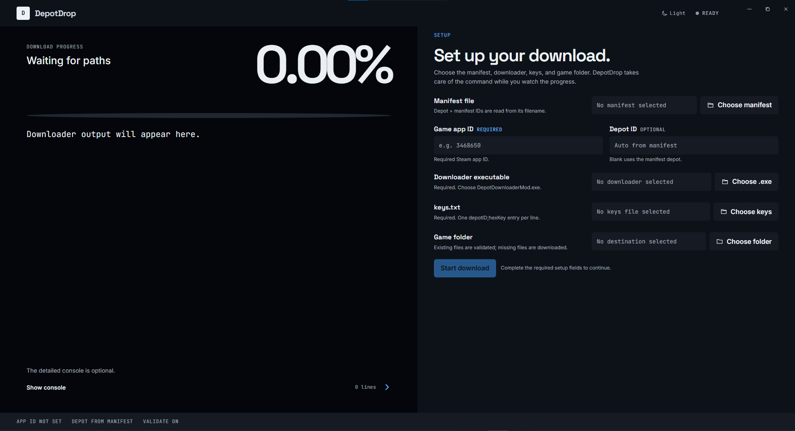

# DepotDrop

> A small Windows desktop UI for downloading and validating a Steam depot without typing a long DepotDownloader command.

DepotDrop wraps the local `DepotDownloaderMod.exe` workflow with guided setup: choose the manifest, app ID, downloader executable, depot keys, and destination folder, then watch the real downloader progress in the app.



## Download for Windows

Download the latest ready-to-run `.exe` from the [GitHub Releases page](https://github.com/wahajnintyeight/DDM-GUI/releases/latest). The packaged app requires the Windows WebView2 Runtime, which is already present on most current Windows installations.

## What it does

- Reads any manifest filename matching `DEPOTID_MANIFESTID.manifest`.
- Extracts the depot ID and manifest ID from that filename; the values are not hardcoded to a particular game.
- Accepts any numeric game app ID, so the UI is not tied to one community or game.
- Lets users choose `DepotDownloaderMod.exe` and `keys.txt` from any local paths.
- Runs the downloader with `-validate` using process arguments instead of a shell command.
- Streams percentage progress, the current file, and a bounded output log.
- Supports cancellation and clear startup, error, cancelled, and completed states.

## Quick start

You need these local inputs:

```text
DepotDownloaderMod.exe
keys.txt
<depotID>_<manifestID>.manifest
```

### `keys.txt` format

Use plain text with one depot key per line:

```text
<depotID>;<hexKey>
```

For example, a file containing keys for two depots has two lines. Use the 64-character hexadecimal depot decryption key supplied for each depot; do not include quotes or extra formatting.

They do not need to be in the same folder. DepotDrop never downloads, embeds, uploads, or commits the downloader or keys file; users select their own trusted copies.

Then:

1. Build or download `DDM-GUI.exe`.
2. Open the app.
3. Enter the game app ID (required).
4. Choose a `.manifest` file named `DEPOTID_MANIFESTID.manifest`. The depot ID is filled from its filename when possible.
5. Choose `DepotDownloaderMod.exe`.
6. Choose `keys.txt`.
7. Choose an existing game destination folder.
8. Select **Start download**.

The app does not read or transmit the contents of the manifest, depot keys, or downloader executable. It passes their selected local paths directly to the downloader.

## Build from source

Requirements:

- Go 1.23+
- Node.js 20+
- Wails CLI 2.11+
- WebView2 Runtime on Windows

```powershell
npm install --prefix frontend
go test ./...
wails build -clean
```

The production executable is written to `build/bin/DDM-GUI.exe`.

For live development:

```powershell
wails dev
```

## Project layout

| Path | Purpose |
| --- | --- |
| `app.go` | Wails lifecycle and native file/folder dialogs |
| `download.go` | Manifest parsing, command construction, process execution, and progress parsing |
| `download_test.go` | Parser and command-contract checks |
| `frontend/src/main.js` | Guided setup and live download state |
| `frontend/src/style.css` | Responsive Cobalt/Workbench interface |
| `frontend/tokens.css` | Shared visual tokens |

## Safety notes

DepotDrop validates the selected paths, requires the app ID and keys file, and accepts a blank depot ID only when the manifest filename provides one. It passes arguments directly to the executable, which avoids shell quoting problems for folders containing spaces. Review the downloader and keys bundle and their provenance before using them.

## License

No license has been selected yet. Add one before redistributing the project.
